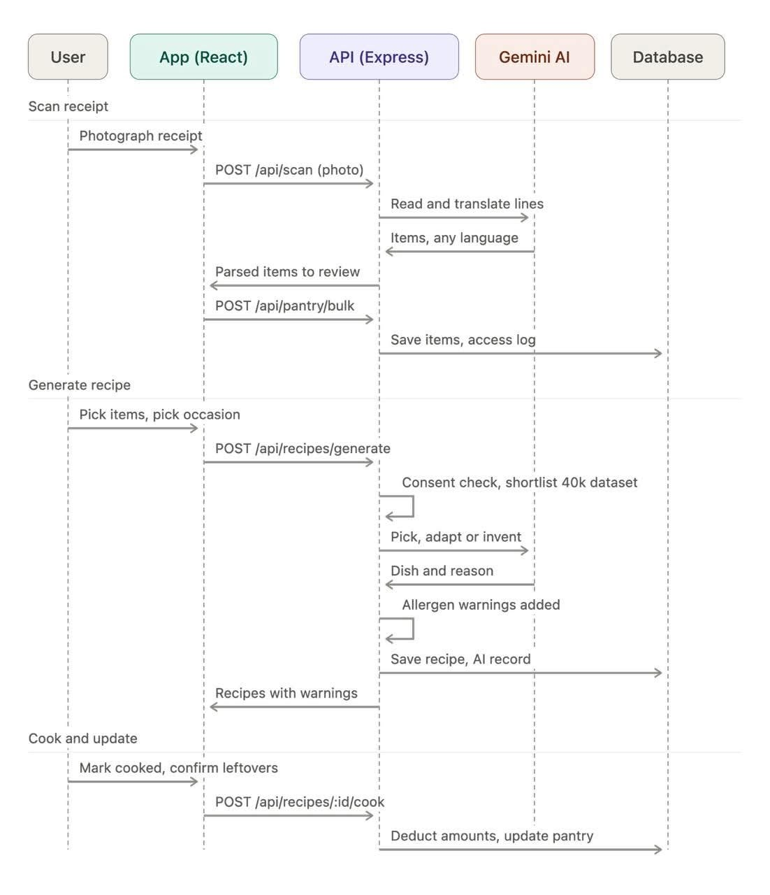

# Diagram 5 — Sequence

Shows the three flows of the core workflow across the running system (User →
App (React) → API (Express) → Gemini AI → Database):

- **Scan receipt** — the app POSTs the photo to the API, which sends it to
  Gemini to read and translate the item lines, returns them to the app for
  review, then saves the confirmed items to the database with an access log
  entry (CCA §26).
- **Generate recipe** — the app POSTs the picked items and occasion; the API
  checks consent, shortlists the recipe dataset locally, asks Gemini to
  pick/adapt/invent a dish, adds allergen warnings itself (never trusting the
  model alone), then saves the recipe and its AI record (model, prompt
  inputs, timestamp — ETA §26/28) before returning it with warnings attached.
- **Cook and update** — marking a recipe cooked posts to the API, which
  deducts the used amounts from pantry quantities in the database.

