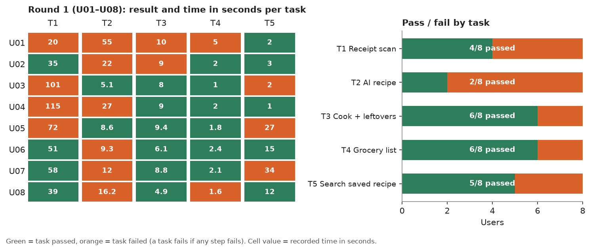

# UAT Session Logs — Round 1 (U01–U08)

**Product:** What2Cook — Smart Recipe & Pantry Assistant · **Method:** task-based UAT, 5 tasks (T1–T5) as defined in [01-test-plan.md](01-test-plan.md) §3.2 · **Moderator never helps or points.**

Every value below is transcribed from the team's UAT session record (the Round 1 session-record document kept by the team, not stored in this repo), filled in by the note-taker during the session. Nothing is estimated or added. Participants are identified by code only.

Scoring rules used by the note-takers: a task passes only if every step passes · time starts when the task prompt is read aloud and stops when the user says they are done · errors = wrong taps, dead ends, moderator prompts · severity 1 cosmetic, 2 minor, 3 major, 4 catastrophic (blocks release).

> **Code mapping.** The original record labels the first four participants `U01`–`U04` and the next four `UT05`–`UT08`. They are normalised here to `U01`–`U08` (the code format defined in the test plan); the original label is shown in each session's info table.

> **Date.** Round 1 took place on 4 Nov 2026 

## Round overview

| Participant | T1 | T2 | T3 | T4 | T5 | Tasks passed |
|---|---|---|---|---|---|---|
| U01 | ❌ 20 | ❌ 55 | ❌ 2 taps, 10s | ❌ 5s | ✅ 2s | 1/5 |
| U02 | ✅ 35 | ❌ 22s | ❌ 2 taps, 9s | ✅ 2s | ✅ 3s | 3/5 |
| U03 | ❌ 101s | ✅ 5.1 | ✅ 2 taps, 8s | ✅ 1s | ❌ 2s | 3/5 |
| U04 | ❌ 115s | ❌ 27s | ✅ 2 taps, 9s | ✅ 2s | ✅ 1s | 3/5 |
| U05 | ❌ 72 | ✅ 8.6 | ✅ 9.4 | ✅ 1.8 | ❌ 27 | 3/5 |
| U06 | ✅ 51 | ❌ 9.3 | ✅ 6.1 | ✅ 2.4 | ✅ 15 | 4/5 |
| U07 | ✅ 58 | ❌ 12 | ✅ 8.8 | ✅ 2.1 | ❌ 34 | 3/5 |
| U08 | ✅ 39 | ❌ 16.2 | ✅ 4.9 | ❌ 1.6 | ✅ 12 | 3/5 |

Times are in seconds as written on the record (T3 also shows taps where recorded).

### Round 1 summary (as printed on the record)

| Task | Pass rate | Median time (s) |
|---|---|---|
| T1 Receipt scan | 4/8 | 54.5 |
| T2 AI recipe | 2/8 | 14.1 |
| T3 Cook + leftovers | 6/8 | 8.9 |
| T4 Grocery list | 6/8 | 2 |
| T5 Search saved recipe | 5/8 | 7.5 |

---

## U01

### Session info

| Field | Entry |
|---|---|
| Participant code | U01 |
| Date | 4 Nov 2026 |
| Moderator | Eaindray Su Pan |
| Note-taker | Thwin Khant Nyar Zaw |
| Test device (model, OS) | I phone 14 |
| Persona (cooks 4+/week, or student) | Student(Cook 3+/week) |
| PDPA consent signed | Yes |
| Recording permission | Yes (Photo) |

### Task summary

| Task | Target | Time (s) | Errors | Result |
|---|---|---|---|---|
| T1 Receipt scan | ≤ 60 s | 20 | AI Reader cannot read the photo. Try again error. | ❌ Fail |
| T2 AI recipe | ≤ 10 s generation | 55 | Generation is taking too long | ❌ Fail |
| T3 Cook + leftovers | ≤ 2 taps, < 10 s | 2 taps, 10s | None | ❌ Fail |
| T4 Grocery list | < 3 s render | 5s | None | ❌ Fail |
| T5 Search saved recipe | Record actual | 2s | None | ✅ Pass |

### Step-level observations

Steps where the actual output differed from expected, or where the note-taker wrote a comment (all other steps: *as expected / Pass*).

| Task / step | Action | Actual output | Result | Comments |
|---|---|---|---|---|
| T1 / 3 | Review and correct misread items | Failed at scanning | **Fail** |  |
| T1 / 4 | Confirm and save | As expected, saved in 10s | Pass |  |
| T2 / 3 | Wait for the result | Generation taking too long over 30s | **Fail** |  |
| T2 / 4 | Read the ingredient list | All recipes are required to buy at least 2 items | **Fail** | Result not accurate and suitable |
| T3 / 2 | Adjust quantities if needed | Box not match actual leftovers | **Fail** | Leftover extraction showing wrong quantity |
| T3 / 3 | Confirm | Pantry Item not changed | **Fail** | Clicking button does not deducted from pantry |
| T4 / 1 | Open the grocery list | Rendered in 5s | **Fail** | A little slowing |

### Issues found

| Issue | Task / step | Severity (1–4) |
|---|---|---|
| AI Reader could not read the receipt photo ("Try again" error); recipe generation took over 30 s; generated recipes needed at least 2 items not in the pantry | T1 / step 3; T2 / step 3; T2 / step 4 | 3; 3; 3 |
| Leftover-confirm box showed wrong quantities; confirming did not deduct items from the pantry; grocery list took 5 s to render | T3 / step 2; T3 / step 3; T4 / step 1 | 3; 3; 2 |

---

## U02

### Session info

| Field | Entry |
|---|---|
| Participant code | U02 |
| Date | 4 Nov 2026 |
| Moderator | Eaindray Su Pan |
| Note-taker | Kyu Kyu Thin |
| Test device (model, OS) | I phone 15 Pro |
| Persona (cooks 4+/week, or student) | Student(Cook 3+/week) |
| PDPA consent signed | Yes |
| Recording permission | Yes (Photo) |

### Task summary

| Task | Target | Time (s) | Errors | Result |
|---|---|---|---|---|
| T1 Receipt scan | ≤ 60 s | 35 | None | ✅ Pass |
| T2 AI recipe | ≤ 10 s generation | 22s | Generation took 22 s | ❌ Fail |
| T3 Cook + leftovers | ≤ 2 taps, < 10 s | 2 taps, 9s | Wrong leftover quantities | ❌ Fail |
| T4 Grocery list | < 3 s render | 2s | None | ✅ Pass |
| T5 Search saved recipe | Record actual | 3s | None | ✅ Pass |

### Step-level observations

Steps where the actual output differed from expected, or where the note-taker wrote a comment (all other steps: *as expected / Pass*).

| Task / step | Action | Actual output | Result | Comments |
|---|---|---|---|---|
| T1 / 3 | Review and correct misread items | As expected | Pass | Some pantry quantity not correct |
| T1 / 4 | Confirm and save | As expected, saved in 23 s | Pass |  |
| T2 / 3 | Wait for the result | Recipe returned after 22 s | **Fail** | Target is 10 s. |
| T3 / 2 | Adjust quantities if needed | All quantities are wrong | **Fail** | Showing wrong quantities in boxes |
| T3 / 3 | Confirm | As expected, 2 taps in 9 s | Pass |  |
| T4 / 1 | Open the grocery list | As expected, rendered in 2 s | Pass |  |

### Issues found

| Issue | Task / step | Severity (1–4) |
|---|---|---|
| Recipe generation took 22 s against the 10 s target | T2 / step 3 | 3 |
| Leftover-confirm box showed wrong quantities for all items | T3 / step 2 | 3 |

---

## U03

### Session info

| Field | Entry |
|---|---|
| Participant code | U03 |
| Date | 4 Nov 2026 |
| Moderator | Thwin Khant Nyar Zaw |
| Note-taker | Hsu Myat Thwe |
| Test device (model, OS) | Samsung S23 |
| Persona (cooks 4+/week, or student) | Student(Cook 3+/week) |
| PDPA consent signed | Yes |
| Recording permission | Yes (Photo) |

### Task summary

| Task | Target | Time (s) | Errors | Result |
|---|---|---|---|---|
| T1 Receipt scan | ≤ 60 s | 101s | 2 wrong taps | ❌ Fail |
| T2 AI recipe | ≤ 10 s generation | 5.1 | None | ✅ Pass |
| T3 Cook + leftovers | ≤ 2 taps, < 10 s | 2 taps, 8s | None | ✅ Pass |
| T4 Grocery list | < 3 s render | 1s | None | ✅ Pass |
| T5 Search saved recipe | Record actual | 2s | 1 extra tap | ❌ Fail |

### Step-level observations

Steps where the actual output differed from expected, or where the note-taker wrote a comment (all other steps: *as expected / Pass*).

| Task / step | Action | Actual output | Result | Comments |
|---|---|---|---|---|
| T1 / 1 | Open the receipt scanner | As expected | Pass | The user chose "Choose Photo" instead of the camera. |
| T1 / 4 | Confirm and save | All items saved, no typing, but total time 101 s | **Fail** | Over the 60 s target; 2 wrong taps while looking for the upload option. |
| T3 / 3 * | Confirm | As expected, 2 taps in 8 s | Pass |  |
| T4 / 1 | Open the grocery list | As expected, rendered in 1 s | Pass |  |
| T5 / 3 | Check the grocery-list pool | User had to tap "Add 2 missing items to list" to pool the ingredients | **Fail** | Expected to happen automatically with 0 extra taps. |

* In the original record the step table for U03 appears under the heading "T2 — AI recipe from selected pantry items" but contains the T3 (mark cooked / leftovers) steps, and no separate T2 step table is present. The task-summary row for T2 (5.1 s, None, Pass) is used for T2.

### Issues found

| Issue | Task / step | Severity (1–4) |
|---|---|---|
| Receipt scan to saved pantry took 101 s against the 60 s target | T1 / step 4 | 3 |
| Missing ingredients are not pooled into the grocery list automatically; user had to tap "Add 2 missing items to list" | T5 / step 3 | 2 |

---

## U04

### Session info

| Field | Entry |
|---|---|
| Participant code | U04 |
| Date | 4 Nov 2026 |
| Moderator | Thwin Khant Nyar Zaw |
| Note-taker | Eaindray Su Pan |
| Test device (model, OS) | XiaoMi Note 14 Pro |
| Persona (cooks 4+/week, or student) | Student(Cook 3+/week) |
| PDPA consent signed | Yes |
| Recording permission | Yes (Photo) |

### Task summary

| Task | Target | Time (s) | Errors | Result |
|---|---|---|---|---|
| T1 Receipt scan | ≤ 60 s | 115s | 2 retries | ❌ Fail |
| T2 AI recipe | ≤ 10 s generation | 27s | Generation took 27 s | ❌ Fail |
| T3 Cook + leftovers | ≤ 2 taps, < 10 s | 2 taps, 9s | None | ✅ Pass |
| T4 Grocery list | < 3 s render | 2s | None | ✅ Pass |
| T5 Search saved recipe | Record actual | 1s | None | ✅ Pass |

### Step-level observations

Steps where the actual output differed from expected, or where the note-taker wrote a comment (all other steps: *as expected / Pass*).

| Task / step | Action | Actual output | Result | Comments |
|---|---|---|---|---|
| T1 / 2 | Photograph or upload the receipt | Shown "Something went wrong on our side. Try again"; user retried | **Fail** | Reading stalled about 55 s, showed the error, then stalled again. Finally parsed "14 items found, 100%" at 115 s. |
| T1 / 4 | Confirm and save | All items saved, but total time 115 s | **Fail** | Over the 60 s target because of the stall in step 2. |
| T2 / 3 | Wait for the result | Recipe returned after 27 s | **Fail** | Target is 10 s. |
| T3 / 3 | Confirm | As expected, 2 taps in 9 s | Pass |  |
| T4 / 1 | Open the grocery list | As expected, rendered in 2 s | Pass |  |

### Issues found

| Issue | Task / step | Severity (1–4) |
|---|---|---|
| Receipt reading stalled about 55 s, showed "Something went wrong on our side. Try again", then stalled again; parsing finished only at 115 s | T1 / step 2 | 3 |
| Recipe generation took 27 s against the 10 s target | T2 / step 3 | 3 |

---

## U05

### Session info

| Field | Entry |
|---|---|
| Participant code | U05 (labelled `UT05` in the original record) |
| Date | 4 Nov 2026 |
| Moderator | Hsu Myat Thwe |
| Note-taker | Thwin Khant Nyar Zaw |
| Test device (model, OS) | iPhone 17 pro max, iOS 18.6 |
| Persona (cooks 4+/week, or student) | Cooks 4+/week |
| PDPA consent signed | Yes |
| Recording permission | Yes (Photo) |

### Task summary

| Task | Target | Time (s) | Errors | Result |
|---|---|---|---|---|
| T1 Receipt scan | ≤ 60 s | 72 | 2 | ❌ Fail |
| T2 AI recipe | ≤ 10 s generation | 8.6 | 0 | ✅ Pass |
| T3 Cook + leftovers | ≤ 2 taps, < 10 s | 9.4 | 0 | ✅ Pass |
| T4 Grocery list | < 3 s render | 1.8 | 0 | ✅ Pass |
| T5 Search saved recipe | Record actual | 27 | 1 | ❌ Fail |

### Step-level observations

Steps where the actual output differed from expected, or where the note-taker wrote a comment (all other steps: *as expected / Pass*).

| Task / step | Action | Actual output | Result | Comments |
|---|---|---|---|---|
| T1 / 2 | Photograph or upload the receipt | First photo blurred (receipt was folded); user retook it. Second photo parsed 14 lines. | Pass | No hint on screen to flatten the receipt. |
| T1 / 3 | Review and correct misread items | 12 of 14 lines correct (86%). Fixed "TOM CHRY" to cherry tomatoes and rice qty 5 → 1 bag. | Pass | Hesitated: unsure whether to tap the item name or the pencil icon. |
| T1 / 4 | Confirm and save | All 14 items saved to pantry, no typing, but total time 72 s. | **Fail** | Over the 60 s target, mainly from the retake and the edit hesitation. |
| T2 / 1 | Select 2–4 pantry items | Selected chicken breast, holy basil, garlic. | Pass |  |
| T2 / 3 | Wait for the result | Recipe returned in 8.6 s. | Pass | Recipe: stir-fried basil chicken. |
| T2 / 4 | Read the ingredient list | Only selected items + staples (rice, fish sauce, oil). 0 dietary violations (no-pork filter). | Pass | Said portion size suits one person. |
| T3 / 2 | Adjust quantities if needed | No adjustment needed. | Pass | Read every row before confirming. |
| T3 / 3 | Confirm | Pantry deducted correctly; 2 taps, 9.4 s. | Pass | Close to the 10 s limit. |
| T4 / 1 | Open the grocery list | Rendered in 1.8 s. | Pass |  |
| T5 / 1 | Search saved recipes by an ingredient | Typed "chicken" into the pantry search, never found the saved-recipes search box, then scrolled the Saved list to find the recipe. | **Fail** | Search not performed; 1 wrong tap (wrong search box). |

### Issues found

| Issue | Task / step | Severity (1–4) |
|---|---|---|
| Edit control on receipt-review rows is not obvious | T1 / step 3 | 2 |
| Blurred receipt photo gives no retake guidance | T1 / step 2 | 2 |
| Saved-recipe search box was not noticed; user typed into the pantry search instead (the two look the same) | T5 / step 1 | 2 |

---

## U06

### Session info

| Field | Entry |
|---|---|
| Participant code | U06 (labelled `UT06` in the original record) |
| Date | 4 Nov 2026 |
| Moderator | Hsu Myat Thwe |
| Note-taker | Kyu Kyu Thin |
| Test device (model, OS) | iPhone 15 pro, IOS 18.6 |
| Persona (cooks 4+/week, or student) | Student (MSc) |
| PDPA consent signed | Yes |
| Recording permission | No |

### Task summary

| Task | Target | Time (s) | Errors | Result |
|---|---|---|---|---|
| T1 Receipt scan | ≤ 60 s | 51 | 0 | ✅ Pass |
| T2 AI recipe | ≤ 10 s generation | 9.3 | 0 | ❌ Fail |
| T3 Cook + leftovers | ≤ 2 taps, < 10 s | 6.1 | 0 | ✅ Pass |
| T4 Grocery list | < 3 s render | 2.4 | 0 | ✅ Pass |
| T5 Search saved recipe | Record actual | 15 | 0 | ✅ Pass |

### Step-level observations

Steps where the actual output differed from expected, or where the note-taker wrote a comment (all other steps: *as expected / Pass*).

| Task / step | Action | Actual output | Result | Comments |
|---|---|---|---|---|
| T1 / 2 | Photograph or upload the receipt | 15 lines parsed. | Pass |  |
| T1 / 3 | Review and correct misread items | 13 of 15 lines correct (87%). Both misreads were abbreviated brand names. | Pass | Counted the misreads himself before correcting. |
| T1 / 4 | Confirm and save | All 15 items saved, no typing, 51 s. | Pass |  |
| T2 / 1 | Select 2–4 pantry items | Selected spinach, mushrooms, eggs. | Pass |  |
| T2 / 3 | Wait for the result | Recipe returned in 9.3 s. | Pass | Asked if the time depends on the number of items. |
| T2 / 4 | Read the ingredient list | Recipe added heavy cream, which is not in the pantry and not a staple. 0 dietary violations (vegetarian filter). | **Fail** | Breaks NFR5: pantry items + staples only. |
| T3 / 2 | Adjust quantities if needed | Changed eggs left from 2 to 1 with the stepper. | Pass | Matched his real leftovers. |
| T3 / 3 | Confirm | Pantry deducted correctly; 2 taps, 6.1 s. | Pass |  |
| T4 / 1 | Open the grocery list | Rendered in 2.4 s. | Pass |  |
| T4 / 2 | Check the list against pantry stock | As expected | Pass | Heavy cream from T2 recipe appeared on list, which is correct since it is missing. |
| T5 / 1 | Search saved recipes by an ingredient | Searched "mushroom"; 2 matching recipes returned. | Pass |  |

### Issues found

| Issue | Task / step | Severity (1–4) |
|---|---|---|
| AI recipe used an ingredient not in pantry or staples (heavy cream) | T2 / step 4 | 3 |
| No confidence indicator on scanned lines | T1 / step 3 | 1 |

---

## U07

### Session info

| Field | Entry |
|---|---|
| Participant code | U07 (labelled `UT07` in the original record) |
| Date | 4 Nov 2026 |
| Moderator | Kyu Kyu Thin |
| Note-taker | Hsu Myat Thwe |
| Test device (model, OS) | iphone 15 pro, IOS 18.6 |
| Persona (cooks 4+/week, or student) | Student |
| PDPA consent signed | Yes |
| Recording permission | No |

### Task summary

| Task | Target | Time (s) | Errors | Result |
|---|---|---|---|---|
| T1 Receipt scan | ≤ 60 s | 58 | 1 | ✅ Pass |
| T2 AI recipe | ≤ 10 s generation | 12 | 0 | ❌ Fail |
| T3 Cook + leftovers | ≤ 2 taps, < 10 s | 8.8 | 0 | ✅ Pass |
| T4 Grocery list | < 3 s render | 2.1 | 0 | ✅ Pass |
| T5 Search saved recipe | Record actual | 34 | 1 | ❌ Fail |

### Step-level observations

Steps where the actual output differed from expected, or where the note-taker wrote a comment (all other steps: *as expected / Pass*).

| Task / step | Action | Actual output | Result | Comments |
|---|---|---|---|---|
| T1 / 1 | Open the receipt scanner | Opened scanner, tapped Upload, then cancelled and switched to camera. | Pass | 1 wrong tap. Read the PDPA consent text in full before starting. |
| T1 / 2 | Photograph or upload the receipt | 12 lines parsed. | Pass | Asked if the receipt image is stored. Moderator did not answer (per protocol). |
| T1 / 3 | Review and correct misread items | 11 of 12 lines correct (92%). Fixed tofu quantity. | Pass |  |
| T1 / 4 | Confirm and save | All 12 items saved, no typing, 58 s. | Pass | Just under the 60 s target. |
| T2 / 1 | Select 2–4 pantry items | Selected tofu, bok choy, garlic. | Pass | Peanut-allergy filter set on test account. |
| T2 / 3 | Wait for the result | Recipe returned in 12 s. | **Fail** | Target is 10 s. |
| T2 / 4 | Read the ingredient list | Only selected items + staples. 0 dietary violations. | Pass | Checked the oil type specifically for peanut oil. |
| T3 / 2 | Adjust quantities if needed | No adjustment needed. | Pass |  |
| T3 / 3 | Confirm | Pantry deducted correctly; 2 taps, 8.8 s. | Pass |  |
| T4 / 1 | Open the grocery list | Rendered in 2.1 s. | Pass |  |
| T5 / 1 | Search saved recipes by an ingredient | Searched "tofu"; correct recipe returned. | Pass |  |
| T5 / 3 | Check the grocery-list pool | Recipe did not appear in the grocery-list pool until the page was refreshed manually. | **Fail** | 1 moderator prompt needed to move on. |

### Issues found

| Issue | Task / step | Severity (1–4) |
|---|---|---|
| Selected recipe not pooled into grocery list until manual refresh | T5 / step 3 | 3 |
| Consent screen does not say receipt images are deleted after parsing; session stays signed in after closing the tab (no idle timeout) | T1 / step 2; General | 2; 2 |
| Recipe generation took 12 s against the 10 s target | T2 / step 3 | 2 |

---

## U08

### Session info

| Field | Entry |
|---|---|
| Participant code | U08 (labelled `UT08` in the original record) |
| Date | 4 Nov 2026 |
| Moderator | Kyu Kyu Thin |
| Note-taker | Eaindray Su Pan |
| Test device (model, OS) | iPhone 15, iOS 18.6 |
| Persona (cooks 4+/week, or student) | Student |
| PDPA consent signed | Yes |
| Recording permission | No |

### Task summary

| Task | Target | Time (s) | Errors | Result |
|---|---|---|---|---|
| T1 Receipt scan | ≤ 60 s | 39 | 0 | ✅ Pass |
| T2 AI recipe | ≤ 10 s generation | 16.2 | 0 | ❌ Fail |
| T3 Cook + leftovers | ≤ 2 taps, < 10 s | 4.9 | 0 | ✅ Pass |
| T4 Grocery list | < 3 s render | 1.6 | 0 | ❌ Fail |
| T5 Search saved recipe | Record actual | 12 | 0 | ✅ Pass |

### Step-level observations

Steps where the actual output differed from expected, or where the note-taker wrote a comment (all other steps: *as expected / Pass*).

| Task / step | Action | Actual output | Result | Comments |
|---|---|---|---|---|
| T1 / 2 | Photograph or upload the receipt | 18 lines parsed. | Pass |  |
| T1 / 3 | Review and correct misread items | 16 of 18 lines correct (89%). Fixed two quantity misreads. | Pass |  |
| T1 / 4 | Confirm and save | All 18 items saved, no typing, 39 s. | Pass | Fastest session so far. |
| T2 / 1 | Select 2–4 pantry items | Selected eggs, tomatoes, onion, rice. | Pass |  |
| T2 / 3 | Wait for the result | Recipe returned in 16.2 s. | **Fail** | Over the 10 s target. Recipe: tomato egg fried rice. |
| T2 / 4 | Read the ingredient list | Only selected items + staples. 0 dietary violations (no filter set). | Pass |  |
| T3 / 1 | Tap "mark cooked" | Box opened; the "mark cooked" button shifted down as the page loaded. | Pass | Nearly mis-tapped due to layout shift. |
| T3 / 3 | Confirm | Pantry deducted correctly; 2 taps, 4.9 s. | Pass |  |
| T4 / 1 | Open the grocery list | Rendered in 1.6 s. | Pass |  |
| T4 / 2 | Check the list against pantry stock | Eggs listed although pantry holds 6 eggs. Pantry unit is "pcs", recipe unit is "pack". | **Fail** | Breaks NFR7. Likely unit-matching bug. |
| T5 / 1 | Search saved recipes by an ingredient | Searched "egg"; correct recipes returned. | Pass |  |

### Issues found

| Issue | Task / step | Severity (1–4) |
|---|---|---|
| Grocery list includes already-stocked eggs (unit mismatch pcs vs pack) | T4 / step 2 | 3 |
| Recipe generation took 16.2 s against the 10 s target; layout shift moves the "mark cooked" button during load | T2 / step 3; T3 / step 1 | 2; 1 |

---
