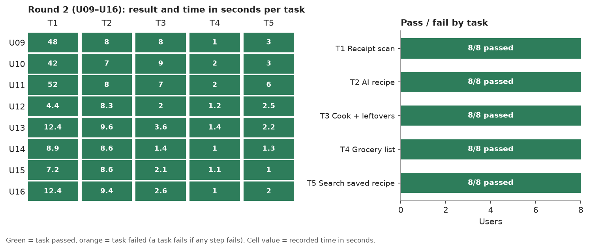

# UAT Session Logs — Round 2 (U09–U16)

**Product:** What2Cook — Smart Recipe & Pantry Assistant · **Method:** task-based UAT, 5 tasks (T1–T5) as defined in [01-test-plan.md](01-test-plan.md) §3.2 · **Moderator never helps or points.**

Every value below is transcribed from the team's UAT session record (the Round 2 session-record document kept by the team, not stored in this repo), filled in by the note-taker during the session. Nothing is estimated or added. Participants are identified by code only.

Scoring rules used by the note-takers: a task passes only if every step passes · time starts when the task prompt is read aloud and stops when the user says they are done · errors = wrong taps, dead ends, moderator prompts · severity 1 cosmetic, 2 minor, 3 major, 4 catastrophic (blocks release).

> **Code mapping.** The original record labels these participants `UT09`–`UT016`. They are normalised here to `U09`–`U16`; the original label is shown in each session's info table.

> **Dates.** Reproduced as written in each session's record: U09–U11 `12 Nov 2026`, U12 `Nov 08, 2026` †, U13 `Nov 09, 2026`, U14–U16 `Nov 14, 2026`.

> † U12's date reads `Nov 08, 2026` in the Round 2 record while the round's other sessions are 9–14 Nov; it is reproduced as written (see the open questions in the hand-over note).

## Round overview

| Participant | T1 | T2 | T3 | T4 | T5 | Tasks passed |
|---|---|---|---|---|---|---|
| U09 | ✅ 48s | ✅ 8s | ✅ 2 taps, 8s | ✅ 1s | ✅ 3s | 5/5 |
| U10 | ✅ 42s | ✅ 7s | ✅ 2taps, 9s | ✅ 2s | ✅ 3s | 5/5 |
| U11 | ✅ 52s | ✅ 8s | ✅ 2 taps, 7s | ✅ 2s | ✅ 6s | 5/5 |
| U12 | ✅ 4.4 | ✅ 8.3 | ✅ 2 | ✅ 1.2 | ✅ 2.5s | 5/5 |
| U13 | ✅ 12.4 | ✅ 9.6 | ✅ 3.6 | ✅ 1.4 | ✅ 2.2s | 5/5 |
| U14 | ✅ 8.9 | ✅ 8.6 | ✅ 1.4 | ✅ 1 | ✅ 1.3 | 5/5 |
| U15 | ✅ 7.2 | ✅ 8.6 | ✅ 2.1 | ✅ 1.1 | ✅ 1 | 5/5 |
| U16 | ✅ 12.4 | ✅ 9.4 | ✅ 2.6 | ✅ 1 | ✅ 2 | 5/5 |

Times are in seconds as written on the record (T3 also shows taps where recorded).

### Round 2 summary (as printed on the record)

| Task | Pass rate | Median time (s) |
|---|---|---|
| T1 Receipt scan | 8/8 | 12.4 |
| T2 AI recipe | 8/8 | 8.4 |
| T3 Cook + leftovers | 8/8 | 3.1 |
| T4 Grocery list | 8/8 | 1.1 |
| T5 Search saved recipe | 8/8 | 2.4 |

---

## U09

### Session info

| Field | Entry |
|---|---|
| Participant code | U09 (labelled `UT09` in the original record) |
| Date (as written) | 12 Nov 2026 |
| Moderator | Kyu Kyu Thin |
| Note-taker | Eaindray Su Pan |
| Test device (model, OS) | iPhone 11 |
| Persona (cooks 4+/week, or student) | Cook 3+/week, Student |
| PDPA consent signed | Yes |
| Recording permission | Yes |

### Task summary

| Task | Target | Time (s) | Errors | Result |
|---|---|---|---|---|
| T1 Receipt scan | ≤ 60 s | 48s | 0 | ✅ Pass |
| T2 AI recipe | ≤ 10 s generation | 8s | 0 | ✅ Pass |
| T3 Cook + leftovers | ≤ 2 taps, < 10 s | 2 taps, 8s | 0 | ✅ Pass |
| T4 Grocery list | < 3 s render | 1s | 0 | ✅ Pass |
| T5 Search saved recipe | Record actual | 3s | 0 | ✅ Pass |

### Step-level observations

Steps where the actual output differed from expected, or where the note-taker wrote a comment (all other steps: *as expected / Pass*).

| Task / step | Action | Actual output | Result | Comments |
|---|---|---|---|---|
| T1 / 1 | Open the receipt scanner | As expected | Pass | The user chose “Choose Photo” instead of the camera. |
| T1 / 4 | Confirm and save | As expected | Pass | Saved in 48 s, within the 60 s target. |
| T2 / 3 | Wait for the result | As expected | Pass | Recipe returned in 8 s. |
| T5 / 3 | Check the grocery-list pool | As expected | Pass | Missing items pooled automatically, 0 extra taps. |

### Issues found

None observed.

---

## U10

### Session info

| Field | Entry |
|---|---|
| Participant code | U10 (labelled `UT10` in the original record) |
| Date (as written) | 12 Nov 2026 |
| Moderator | Kyu Kyu Thin |
| Note-taker | Hsu Myat Thwe |
| Test device (model, OS) | Nothing 3a |
| Persona (cooks 4+/week, or student) | Cook 5+/week, student |
| PDPA consent signed | Yes |
| Recording permission | Yes |

### Task summary

| Task | Target | Time (s) | Errors | Result |
|---|---|---|---|---|
| T1 Receipt scan | ≤ 60 s | 42s | 0 | ✅ Pass |
| T2 AI recipe | ≤ 10 s generation | 7s | 0 | ✅ Pass |
| T3 Cook + leftovers | ≤ 2 taps, < 10 s | 2taps, 9s | 0 | ✅ Pass |
| T4 Grocery list | < 3 s render | 2s | 0 | ✅ Pass |
| T5 Search saved recipe | Record actual | 3s | 0 | ✅ Pass |

### Step-level observations

Steps where the actual output differed from expected, or where the note-taker wrote a comment (all other steps: *as expected / Pass*).

| Task / step | Action | Actual output | Result | Comments |
|---|---|---|---|---|
| T1 / 2 | Photograph or upload the receipt | As expected | Pass | Parsed "14 items found, 100%" on the first attempt. |
| T1 / 4 | Confirm and save | As expected | Pass | Saved in 42 s, within the 60 s target. |
| T2 / 3 | Wait for the result | Generated in 7 s | Pass | Within the 10 s target. |
| T4 / 1 | Open the grocery list | As expected | Pass | Rendered in 2s |
| T5 / 1 | Search saved recipes by an ingredient | As expected | Pass | Found the search box on the Saved screen straight away. |

### Issues found

None observed.

---

## U11

### Session info

| Field | Entry |
|---|---|
| Participant code | U11 (labelled `UT11` in the original record) |
| Date (as written) | 12 Nov 2026 |
| Moderator | Thwin Khant Nyar Zaw |
| Note-taker | Eaindray Su Pan |
| Test device (model, OS) | Xiaomi 15T Pro |
| Persona (cooks 4+/week, or student) | Cook 3+/week, Student |
| PDPA consent signed | Yes |
| Recording permission | Yes |

### Task summary

| Task | Target | Time (s) | Errors | Result |
|---|---|---|---|---|
| T1 Receipt scan | ≤ 60 s | 52s | 1 | ✅ Pass |
| T2 AI recipe | ≤ 10 s generation | 8s | 0 | ✅ Pass |
| T3 Cook + leftovers | ≤ 2 taps, < 10 s | 2 taps, 7s | 0 | ✅ Pass |
| T4 Grocery list | < 3 s render | 2s | 0 | ✅ Pass |
| T5 Search saved recipe | Record actual | 6s | 1 | ✅ Pass |

### Step-level observations

Steps where the actual output differed from expected, or where the note-taker wrote a comment (all other steps: *as expected / Pass*).

| Task / step | Action | Actual output | Result | Comments |
|---|---|---|---|---|
| T2 / 3 | Wait for the result | Recipes appeared after 8 s | Pass | Within the 10 s target. |

### Issues found

None observed.

---

## U12

### Session info

| Field | Entry |
|---|---|
| Participant code | U12 (labelled `UT012` in the original record) |
| Date (as written) | Nov 08, 2026 † |
| Moderator | Hsu Myat Thwe |
| Note-taker | Eaindary Su Pan |
| Test device (model, OS) | iPhone 12 ProMax, iOS 27.2.1 |
| Persona (cooks 4+/week, or student) | Student who cooks 3+ times/week |
| PDPA consent signed | Yes |
| Recording permission | Yes |

### Task summary

| Task | Target | Time (s) | Errors | Result |
|---|---|---|---|---|
| T1 Receipt scan | ≤ 60 s | 4.4 | 0 | ✅ Pass |
| T2 AI recipe | ≤ 10 s generation | 8.3 | 0 | ✅ Pass |
| T3 Cook + leftovers | ≤ 2 taps, < 10 s | 2 | 0 | ✅ Pass |
| T4 Grocery list | < 3 s render | 1.2 | 0 | ✅ Pass |
| T5 Search saved recipe | Record actual | 2.5s | 0 | ✅ Pass |

### Step-level observations

Steps where the actual output differed from expected, or where the note-taker wrote a comment (all other steps: *as expected / Pass*).

| Task / step | Action | Actual output | Result | Comments |
|---|---|---|---|---|
| T2 / 3 | Wait for the result | Recipe returned in 8.3 s. | Pass | Within the 10 s target. |

### Issues found

None observed.

---

## U13

### Session info

| Field | Entry |
|---|---|
| Participant code | U13 (labelled `UT013` in the original record) |
| Date (as written) | Nov 09, 2026 |
| Moderator | Eaindray Su Pan |
| Note-taker | Kyu Kyu Thin |
| Test device (model, OS) | iPhone 12 ProMax, iOS 27.2.1 |
| Persona (cooks 4+/week, or student) | Student |
| PDPA consent signed | Yes |
| Recording permission | Yes |

### Task summary

| Task | Target | Time (s) | Errors | Result |
|---|---|---|---|---|
| T1 Receipt scan | ≤ 60 s | 12.4 | 0 | ✅ Pass |
| T2 AI recipe | ≤ 10 s generation | 9.6 | 0 | ✅ Pass |
| T3 Cook + leftovers | ≤ 2 taps, < 10 s | 3.6 | 0 | ✅ Pass |
| T4 Grocery list | < 3 s render | 1.4 | 0 | ✅ Pass |
| T5 Search saved recipe | Record actual | 2.2s | 0 | ✅ Pass |

### Step-level observations

Steps where the actual output differed from expected, or where the note-taker wrote a comment (all other steps: *as expected / Pass*).

| Task / step | Action | Actual output | Result | Comments |
|---|---|---|---|---|
| T2 / 3 | Wait for the result | As expected | Pass | Returned in 9.6 s, close to the 10 s limit. |

### Issues found

None observed.

---

## U14

### Session info

| Field | Entry |
|---|---|
| Participant code | U14 (labelled `UT014` in the original record) |
| Date (as written) | Nov 14, 2026 |
| Moderator | Eaindray Su Pan |
| Note-taker | Thwin Khant Nyar Zaw |
| Test device (model, OS) | iPhone 12 ProMax, iOS 27.2.1 |
| Persona (cooks 4+/week, or student) | Student who cooks 4+ times/week |
| PDPA consent signed | Yes |
| Recording permission | Yes |

### Task summary

| Task | Target | Time (s) | Errors | Result |
|---|---|---|---|---|
| T1 Receipt scan | ≤ 60 s | 8.9 | 0 | ✅ Pass |
| T2 AI recipe | ≤ 10 s generation | 8.6 | 0 | ✅ Pass |
| T3 Cook + leftovers | ≤ 2 taps, < 10 s | 1.4 | 0 | ✅ Pass |
| T4 Grocery list | < 3 s render | 1 | 0 | ✅ Pass |
| T5 Search saved recipe | Record actual | 1.3 | 0 | ✅ Pass |

### Step-level observations

Steps where the actual output differed from expected, or where the note-taker wrote a comment (all other steps: *as expected / Pass*).

| Task / step | Action | Actual output | Result | Comments |
|---|---|---|---|---|
| T2 / 3 | Wait for the result | As expected | Pass | Returned in 8.6 s. |

### Issues found

None observed.

---

## U15

### Session info

| Field | Entry |
|---|---|
| Participant code | U15 (labelled `UT015` in the original record) |
| Date (as written) | Nov 14, 2026 |
| Moderator | Hsu Myat Thwe |
| Note-taker | Eaindary Su Pan |
| Test device (model, OS) | iPhone 12 ProMax, iOS 27.2.1 |
| Persona (cooks 4+/week, or student) | Student who cooks 4+ times/week |
| PDPA consent signed | Yes |
| Recording permission | Yes |

### Task summary

| Task | Target | Time (s) | Errors | Result |
|---|---|---|---|---|
| T1 Receipt scan | ≤ 60 s | 7.2 | 0 | ✅ Pass |
| T2 AI recipe | ≤ 10 s generation | 8.6 | 0 | ✅ Pass |
| T3 Cook + leftovers | ≤ 2 taps, < 10 s | 2.1 | 0 | ✅ Pass |
| T4 Grocery list | < 3 s render | 1.1 | 0 | ✅ Pass |
| T5 Search saved recipe | Record actual | 1 | 0 | ✅ Pass |

### Step-level observations

Steps where the actual output differed from expected, or where the note-taker wrote a comment (all other steps: *as expected / Pass*).

| Task / step | Action | Actual output | Result | Comments |
|---|---|---|---|---|
| T2 / 3 | Wait for the result | As expected | Pass | Returned in 8.6 s. |

### Issues found

None observed.

---

## U16

### Session info

| Field | Entry |
|---|---|
| Participant code | U16 (labelled `UT016` in the original record) |
| Date (as written) | Nov 14, 2026 |
| Moderator | Thwin Khant Nyar Zaw |
| Note-taker | Kyu Kyu Thin |
| Test device (model, OS) | iPhone 12 ProMax, iOS 27.2.1 |
| Persona (cooks 4+/week, or student) | Student who cooks 4+ times/week |
| PDPA consent signed | Yes |
| Recording permission | Yes |

### Task summary

| Task | Target | Time (s) | Errors | Result |
|---|---|---|---|---|
| T1 Receipt scan | ≤ 60 s | 12.4 | 0 | ✅ Pass |
| T2 AI recipe | ≤ 10 s generation | 9.4 | 0 | ✅ Pass |
| T3 Cook + leftovers | ≤ 2 taps, < 10 s | 2.6 | 0 | ✅ Pass |
| T4 Grocery list | < 3 s render | 1 | 0 | ✅ Pass |
| T5 Search saved recipe | Record actual | 2 | 0 | ✅ Pass |

### Step-level observations

Steps where the actual output differed from expected, or where the note-taker wrote a comment (all other steps: *as expected / Pass*).

| Task / step | Action | Actual output | Result | Comments |
|---|---|---|---|---|
| T1 / 4 | Confirm and save | As expected | Pass | Saved in 12.4 s. |
| T2 / 3 | Wait for the result | As expected | Pass | Returned in 9.4 s. |

### Issues found

None observed.

---
