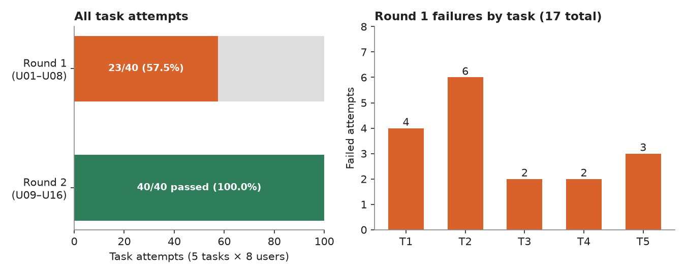
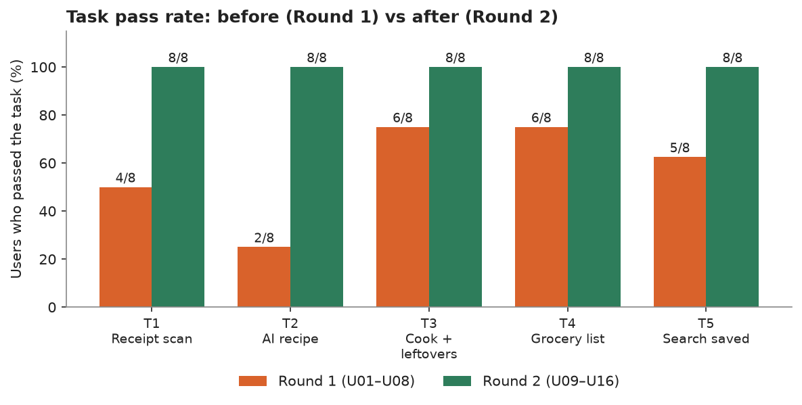
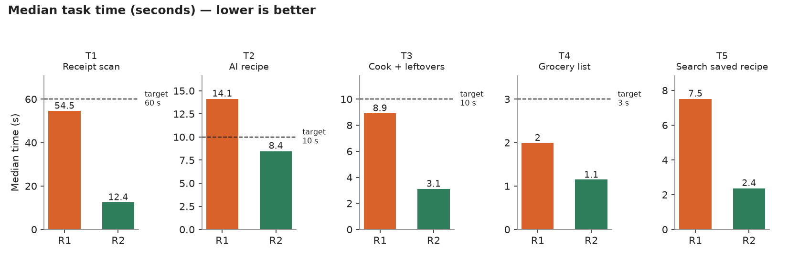
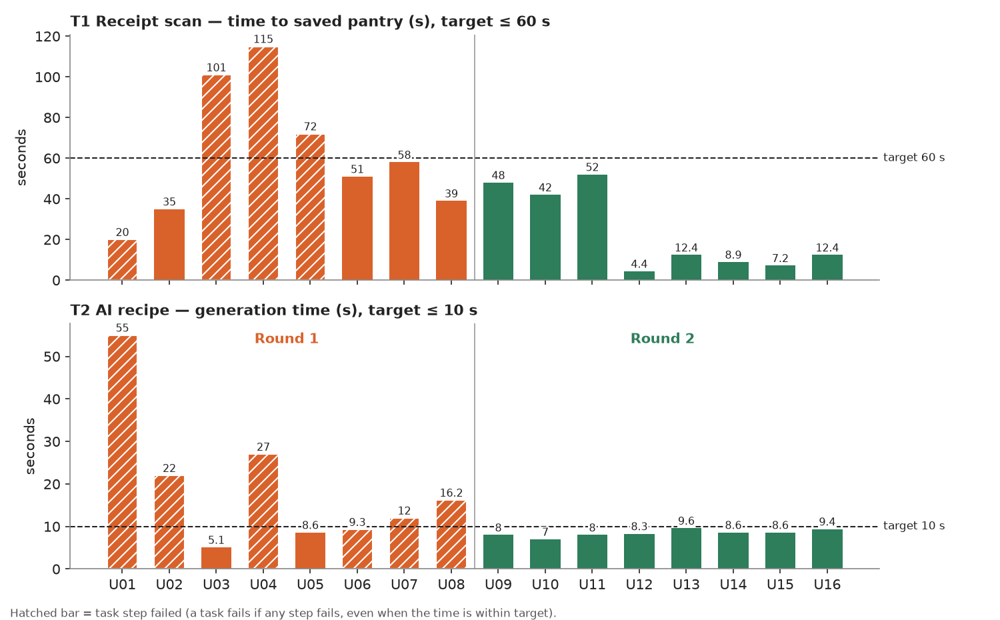
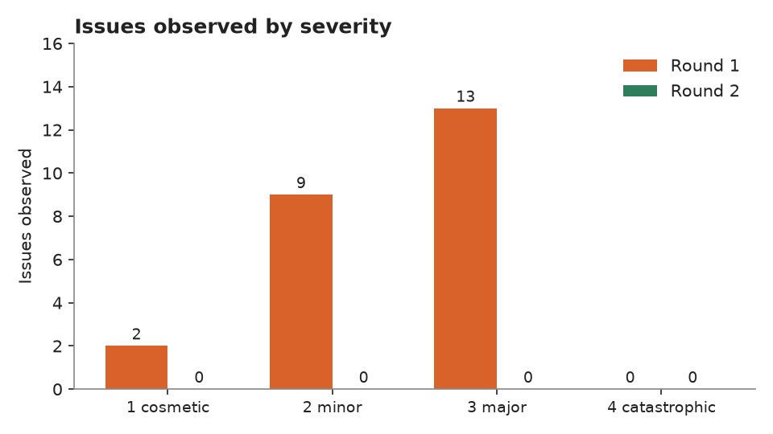

# Before / After — Round 1 vs Round 2

**Before** = Round 1 (U01–U08). **After** = Round 2 (U09–U16), run after the Round 1 fixes, following the two-round design in the test plan §5 (test → fix → test; the fix commits themselves are tracked in [07-issue-log.md](07-issue-log.md)). Same five tasks, same pass/fail rules, same targets, 8 different real users in each round.

**Sources:** [03-uat-session-logs-round1.md](03-uat-session-logs-round1.md), [04-uat-session-logs-round2.md](04-uat-session-logs-round2.md) (transcribed from the team's two UAT session-record documents, which are not stored in this repo). Pass rates and median times reproduce the *Round Summary* tables printed on those records and the *Test Results* slides of the final presentation (slides 5–6). Derived columns are computed from the per-user times in the session logs.

> Each round has 8 participants, so percentages move in 12.5-point steps. These are small-sample usability results, not statistical proof.

## 1. Headline

| Measure | Before (R1) | After (R2) | Change |
|---|---|---|---|
| Task attempts passed | 23/40 (57.5%) | 40/40 (100.0%) | +17 attempts, +42.5 pts |
| Task attempts failed | 17/40 (42.5%) | 0/40 (0.0%) | −17 |
| Users who passed all 5 tasks | 0/8 | 8/8 | +8 users |
| Issues observed (all severities) | 24 | 0 | −24 |
| Severity-3 (major) issues | 13 | 0 | −13 |
| Severity-4 (catastrophic) issues | 0 | 0 | 0 |
| SUS, all 16 users (taken once, not per round) | — | — | mean 71.3, median 72.5 · see [06-sus.md](06-sus.md) |

## 2. Per-task results (the five MUST tasks)

Task → requirement, by task content: T1 ↔ F1 receipt scan · T2 ↔ F3 + F6 AI recipe with dietary filters · T3 ↔ F2 cook & leftover confirm · T4 ↔ F4 grocery list · T5 ↔ F7 saved-recipe search (plus pooling into the F4 list).

| Task | Target | Pass rate before | Pass rate after | Median time before (s) | Median time after (s) | Time change | Within time target before | Within time target after |
|---|---|---|---|---|---|---|---|---|
| T1 Receipt scan | ≤ 60 s | 4/8 (50.0%) | 8/8 (100.0%) | 54.5 | 12.4 | -77% | 5/8 | 8/8 |
| T2 AI recipe | ≤ 10 s generation | 2/8 (25.0%) | 8/8 (100.0%) | 14.1 | 8.4 | -40% | 3/8 | 8/8 |
| T3 Cook + leftovers | ≤ 2 taps, < 10 s | 6/8 (75.0%) | 8/8 (100.0%) | 8.9 | 3.1 | -65% | 7/8 | 8/8 |
| T4 Grocery list | < 3 s render | 6/8 (75.0%) | 8/8 (100.0%) | 2 | 1.1 | -45% | 7/8 | 8/8 |
| T5 Search saved recipe | Record actual | 5/8 (62.5%) | 8/8 (100.0%) | 7.5 | 2.4 | -68% | n/a (no ceiling) | n/a (no ceiling) |

Within-target counts are derived from each user's recorded time (T1 ≤ 60 s, T2 ≤ 10 s, T3 < 10 s, T4 < 3 s). A task can still fail for a non-time reason (for example U06 in T2: heavy cream not in pantry), so these do not always equal the pass counts.

## 3. Round 1 failures, by task and cause (from the session logs)

| Task | Failed | Which users and why (as recorded) |
|---|---|---|
| T1 Receipt scan | 4 | U01 reader could not read photo ("Try again") · U03 101 s, 2 wrong taps finding the upload option · U04 reading stalled, 115 s · U05 72 s after a blurred first photo and edit hesitation |
| T2 AI recipe | 6 | U01 >30 s and recipes needed ≥2 items not in pantry · U02 22 s · U04 27 s · U06 added heavy cream (not in pantry/staples) · U07 12 s · U08 16.2 s |
| T3 Cook + leftovers | 2 | U01 box wrong quantities and confirm did not deduct pantry · U02 all leftover quantities wrong |
| T4 Grocery list | 2 | U01 rendered in 5 s · U08 already-stocked eggs listed (unit mismatch pcs vs pack) |
| T5 Search saved recipe | 3 | U03 had to tap "Add 2 missing items to list" · U05 typed into pantry search, never found saved-recipe search · U07 recipe not pooled until manual refresh |

In Round 2, **no task failed** for any of the 8 users and every Round 2 record lists *None observed* under Issues. See [07-issue-log.md](07-issue-log.md).

## 4. Raw numbers behind the charts

Per-user task times (seconds) — Round 1:

| User | T1 | T2 | T3 | T4 | T5 |
|---|---|---|---|---|---|
| U01 | 20 ❌ | 55 ❌ | 10 ❌ | 5 ❌ | 2 |
| U02 | 35 | 22 ❌ | 9 ❌ | 2 | 3 |
| U03 | 101 ❌ | 5.1 | 8 | 1 | 2 ❌ |
| U04 | 115 ❌ | 27 ❌ | 9 | 2 | 1 |
| U05 | 72 ❌ | 8.6 | 9.4 | 1.8 | 27 ❌ |
| U06 | 51 | 9.3 ❌ | 6.1 | 2.4 | 15 |
| U07 | 58 | 12 ❌ | 8.8 | 2.1 | 34 ❌ |
| U08 | 39 | 16.2 ❌ | 4.9 | 1.6 ❌ | 12 |

Round 2:

| User | T1 | T2 | T3 | T4 | T5 |
|---|---|---|---|---|---|
| U09 | 48 | 8 | 8 | 1 | 3 |
| U10 | 42 | 7 | 9 | 2 | 3 |
| U11 | 52 | 8 | 7 | 2 | 6 |
| U12 | 4.4 | 8.3 | 2 | 1.2 | 2.5 |
| U13 | 12.4 | 9.6 | 3.6 | 1.4 | 2.2 |
| U14 | 8.9 | 8.6 | 1.4 | 1 | 1.3 |
| U15 | 7.2 | 8.6 | 2.1 | 1.1 | 1 |
| U16 | 12.4 | 9.4 | 2.6 | 1 | 2 |

❌ = that task failed for that user.

## 5. Caveats (read before quoting these numbers)

- **Small samples:** 8 users per round. Different users in each round, so the comparison is between two groups, not the same people before and after.
- **What "after" includes:** Round 2 follows the Round 1 fixes; the commit-level mapping of fixes to issues is still to be filled in [07-issue-log.md](07-issue-log.md).
- **Three Round 2 medians** (T2 8.4, T4 1.1, T5 2.4) are as printed on the record; recomputing from the per-user times gives 8.45, 1.15 and 2.35, i.e. the record rounds these half-values down/up by 0.05.
- **Time vs. pass/fail:** a task passes only if every step passes, so a task can pass slowly or fail quickly.
