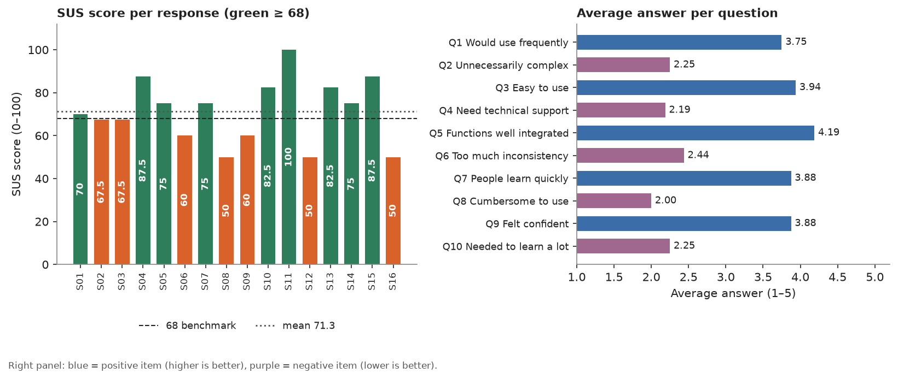

# SUS — System Usability Scale results

**Instrument:** the standard 10-item SUS (Likert 1–5, wording as in [01-test-plan.md](01-test-plan.md) §4, with the product name inserted). Scored per response: odd items score − 1, even items 5 − score, sum × 2.5 → 0–100. Benchmark: 68 (Sauro & Lewis).

**Source:** the team's Google Form export *System Usability Scale (SUS) — Form Responses 1* (16 responses, submitted 8–17 Nov 2026). Every value below is copied from that export; scores are computed from it. The aggregate figures match the *SUS Score* slide of the final presentation (mean 71.3, median 72.5, 9 of 16 at or above 68).

## Result

| Measure | Value |
|---|---|
| Responses | 16 |
| Mean SUS score | **71.3** (71.25) |
| Median | **72.5** |
| Standard deviation | 14.8 |
| Range | 50 – 100 |
| Versus benchmark of 68 | +3.3 above average |
| Responses at or above 68 | 9 of 16 (56.2%) |
| Responses below 68 | 7 of 16 |

## Individual responses

Responses are listed in submission order and labelled S01–S16. The form was anonymous: it records a timestamp only, so a response cannot be tied to a UAT participant code (U01–U16) and none is claimed.

| Response | Submitted | Q1 | Q2 | Q3 | Q4 | Q5 | Q6 | Q7 | Q8 | Q9 | Q10 | SUS score |
|---|---|---|---|---|---|---|---|---|---|---|---|---|
| S01 | 11/8/2026 22:07:05 | 3 | 4 | 4 | 2 | 4 | 4 | 5 | 1 | 4 | 1 | **70** |
| S02 | 11/9/2026 14:27:04 | 3 | 2 | 4 | 2 | 3 | 2 | 4 | 2 | 3 | 2 | **67.5** |
| S03 | 11/9/2026 14:28:19 | 4 | 2 | 4 | 2 | 3 | 2 | 3 | 2 | 3 | 2 | **67.5** |
| S04 | 11/9/2026 16:46:19 | 4 | 2 | 4 | 2 | 5 | 1 | 4 | 1 | 5 | 1 | **87.5** |
| S05 | 11/9/2026 20:22:31 | 5 | 1 | 3 | 1 | 3 | 3 | 5 | 3 | 4 | 2 | **75** |
| S06 | 11/9/2026 20:46:52 | 3 | 3 | 2 | 2 | 4 | 3 | 4 | 2 | 3 | 2 | **60** |
| S07 | 11/11/2026 23:37:03 | 3 | 2 | 4 | 1 | 5 | 3 | 5 | 2 | 4 | 3 | **75** |
| S08 | 11/12/2026 18:50:55 | 5 | 5 | 5 | 5 | 5 | 5 | 5 | 5 | 5 | 5 | **50** |
| S09 | 11/14/2026 15:36:43 | 3 | 2 | 4 | 4 | 4 | 3 | 3 | 3 | 4 | 2 | **60** |
| S10 | 11/16/2026 19:17:10 | 4 | 2 | 5 | 3 | 4 | 2 | 5 | 1 | 5 | 2 | **82.5** |
| S11 | 11/16/2026 19:26:43 | 5 | 1 | 5 | 1 | 5 | 1 | 5 | 1 | 5 | 1 | **100** |
| S12 | 11/16/2026 19:27:59 | 3 | 3 | 3 | 3 | 3 | 3 | 3 | 3 | 3 | 3 | **50** |
| S13 | 11/16/2026 20:30:44 | 4 | 1 | 4 | 1 | 5 | 1 | 3 | 1 | 3 | 2 | **82.5** |
| S14 | 11/16/2026 20:31:23 | 3 | 1 | 3 | 1 | 5 | 2 | 3 | 1 | 3 | 2 | **75** |
| S15 | 11/16/2026 20:32:42 | 5 | 1 | 5 | 2 | 4 | 1 | 3 | 1 | 4 | 1 | **87.5** |
| S16 | 11/17/2026 11:30:36 | 3 | 4 | 4 | 3 | 5 | 3 | 2 | 3 | 4 | 5 | **50** |
| **Average** | | 3.75 | 2.25 | 3.94 | 2.19 | 4.19 | 2.44 | 3.88 | 2.00 | 3.88 | 2.25 | **71.25** |

Q1 would use frequently · Q2 unnecessarily complex · Q3 easy to use · Q4 need technical support · Q5 functions well integrated · Q6 too much inconsistency · Q7 people learn quickly · Q8 cumbersome · Q9 felt confident · Q10 needed to learn a lot. (Odd = positive, even = negative.)

## Interpretation

- **Mean 71.3 is above the 68 benchmark** (+3.3) and below the 80.8 "excellent" threshold quoted in the test plan. It is a modest, above-average result, not an excellent one.
- **Strongest items:** Q5 *functions well integrated* (4.19) and Q3 *easy to use* (3.94). **Weakest items:** Q6 *too much inconsistency* (2.44) is the highest-scoring negative item, followed by Q1 *would use frequently* (3.75), the lowest positive item.
- **Spread is wide** (SD 14.8, range 50–100): 7 of 16 responses scored below 68.
- **Three responses scored exactly 50.0:** S08 (answered 5 to every item, including the negatively worded ones), S12 (answered 3 to every item) and S16. S08 and S12 each gave the same answer to all ten items, which can indicate low-effort answering. They are kept in all figures above; excluding S08 and S12 only, the mean of the other 14 would be 74.3. This is a sensitivity note, not a correction.
- **Limits:** n = 16, anonymous convenience sample, not matched to UAT participants, so read the mean as indicative.
