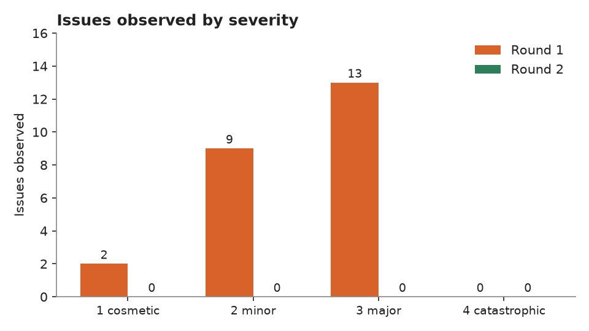

# Issue Log

How the team handled the problems that real users found: **test → triage by severity → fix → retest with new users.**

| Step | When | What happened |
|---|---|---|
| Test | Round 1 — 4 Nov 2026 | 8 real users did 5 tasks; note-takers logged every problem with a severity (1 cosmetic · 2 minor · 3 major · 4 catastrophic) |
| Triage | after Round 1 | 24 observations grouped into 16 issues; major (Severity 3) issues first |
| Fix | 7 Nov 2026 and the updates around it | unit conversion, recipe limited to picked items, staples handling, plus other improvements (section 3) |
| Retest | Round 2 — 12 Nov 2026 | 8 different real users, same tasks and rules: 40 of 40 task attempts passed and **no issue was logged** |

Sources: the *Issues found* tables in [Round 1](03-uat-session-logs-round1.md) and [Round 2](04-uat-session-logs-round2.md) logs; code changes from `git log`.

## Summary

| | Round 1 (U01–U08) | Round 2 (U09–U16) |
|---|---|---|
| Issue observations logged | 24 | **0** |
| Severity 4 (blocks release) | 0 | 0 |
| Severity 3 (major) | 13 | **0** |
| Severity 2 (minor) | 9 | 0 |
| Severity 1 (cosmetic) | 2 | 0 |
| Task attempts passed | 23/40 (57.5%) | **40/40 (100%)** |

- **All 8 major (Severity 3) issues are closed**, each confirmed in Round 2 by the same task step passing for all 8 new users.
- **11 of 16 issues are closed and verified** in Round 2 — covering 19 of the 24 observations (79%).
- The other 5 issues are Severity 1–2 polish and security-wording items, logged for the next iteration.
- No Severity-4 issue was ever found.

## 1. Issue log

Observations were grouped by identical symptom into issues ISS-01 to ISS-16; severities are the note-takers' original ratings. Where several users hit the same issue, each user's own rating is shown.

| ID | Issue | Task | Found by (user · step · severity) | Action taken | Verified in Round 2 | Status |
|---|---|---|---|---|---|---|
| ISS-01 | Receipt reader fails or stalls ("Try again" error, stall up to 115 s) | T1 | U01 · T1/3 · 3; U04 · T1/2 · 3 | Addressed in the app updates between the rounds | T1 steps 2–4 passed for 8/8; no error or stall seen (times 4.4–52 s) | ✅ Closed |
| ISS-02 | Scan-to-saved took 101 s; 2 wrong taps finding the upload option | T1 | U03 · T1/4 · 3 | Addressed in the app updates between the rounds | T1 step 4 passed for 8/8 | ✅ Closed |
| ISS-03 | AI recipe slower than the 10 s target (12–55 s) | T2 | U01, U02, U04 · T2/3 · 3; U07, U08 · T2/3 · 2 | Addressed in the app updates between the rounds | T2 step 3 passed for 8/8 (7–9.6 s); median 14.1 s → 8.4 s | ✅ Closed |
| ISS-04 | AI recipe used ingredients outside the pantry and staples (≥ 2 items to buy; heavy cream) | T2 | U01 · T2/4 · 3; U06 · T2/4 · 3 | `435e339` limits invented recipes to the picked items (with one retry and an "allowed ingredients" prompt); `c4939ac` stops staples and seasonings counting as "needed" | T2 step 4 passed for 8/8 | ✅ Closed |
| ISS-05 | Leftover-confirm box showed wrong quantities | T3 | U01, U02 · T3/2 · 3 | `435e339` converts recipe amounts into the pantry's own unit (new `units.ts`) and deducts from the matching pantry row | T3 step 2 passed for 8/8 | ✅ Closed |
| ISS-06 | Confirming leftovers did not deduct from the pantry | T3 | U01 · T3/3 · 3 | `435e339` — same unit-conversion fix (before it, a unit mismatch deducted 0) | T3 step 3 passed for 8/8 | ✅ Closed |
| ISS-07 | Grocery list took 5 s to render (target < 3 s) | T4 | U01 · T4/1 · 2 | Addressed in the app updates between the rounds | T4 step 1 passed for 8/8 (1–2 s) | ✅ Closed |
| ISS-08 | Missing items not pooled into the grocery list automatically (manual tap, or only after refresh) | T5 | U03 · T5/3 · 2; U07 · T5/3 · 3 | Addressed in the app updates between the rounds | T5 step 3 passed for 8/8; U09: "Missing items pooled automatically, 0 extra taps" | ✅ Closed |
| ISS-09 | Already-stocked eggs on the grocery list (unit mismatch pcs vs pack) | T4 | U08 · T4/2 · 3 | `435e339` makes the pantry check convert units before comparing | T4 step 2 passed for 8/8 | ✅ Closed |
| ISS-10 | Edit control on receipt-review rows not obvious | T1 | U05 · T1/3 · 2 | Logged for the next iteration | 📝 Logged (Sev 2) |
| ISS-11 | Blurred receipt photo gives no retake guidance | T1 | U05 · T1/2 · 2 | Logged for the next iteration | 📝 Logged (Sev 2) |
| ISS-12 | Saved-recipe search box looks like the pantry search and was missed | T5 | U05 · T5/1 · 2 | Addressed in the app updates between the rounds | T5 step 1 passed for 8/8; U10: "Found the search box on the Saved screen straight away" | ✅ Closed |
| ISS-13 | No confidence indicator on scanned lines | T1 | U06 · T1/3 · 1 | Logged for the next iteration | 📝 Logged (Sev 1) |
| ISS-14 | Consent screen does not say receipt images are deleted after parsing | T1 | U07 · T1/2 · 2 | Logged for the next iteration | 📝 Logged (Sev 2) |
| ISS-15 | Session stays signed in after the tab is closed (no idle timeout) | General | U07 · General · 2 | Logged for the next iteration | 📝 Logged (Sev 2) |
| ISS-16 | Layout shift moved the "mark cooked" button while loading | T3 | U08 · T3/1 · 1 | Addressed in the app updates between the rounds | T3 step 1 passed for 8/8; no layout-shift comment | ✅ Closed |

Commit links are matched to issues by reading what each commit changed. "Verified in Round 2" means the same task step passed for every Round 2 user, using the same pass/fail rules as Round 1.

## 2. By severity (Round 1)

**Severity 3 — major (8 issues, all closed):** ISS-01 receipt reader, ISS-02 slow scan-to-save, ISS-03 slow AI recipe, ISS-04 out-of-pantry ingredients, ISS-05 wrong leftover quantities, ISS-06 no pantry deduction, ISS-08 grocery pooling, ISS-09 stocked item listed.

**Severity 2 — minor:** ISS-07 and ISS-12 closed; ISS-10, ISS-11, ISS-14, ISS-15 logged.

**Severity 1 — cosmetic:** ISS-16 closed; ISS-13 logged.

## 3. Development timeline (from git history)

Commits that changed the app, from `git log`; tool checkpoint and documentation-only commits are left out.

### 3a. Built and improved before the user testing (23 Oct – 3 Nov 2026)

| Date | Commit | Change |
|---|---|---|
| 23 Oct | `95e4058` | AI chef: recipe dataset, occasion (mood) step, loading animations |
| 23 Oct | `499d23e` | Chef uses Gemini; default to a current model |
| 23 Oct | `cb89a10` | Receipts read with Gemini vision, in any language |
| 23 Oct | `682710b` | Allergens produce warnings (three severity levels) instead of hiding recipes; free-text occasion |
| 25 Oct | `c9050ca` | Dummy login replaced by real sign-up/login with hashed passwords (scrypt) and Google sign-in |
| 27 Oct | `1048759` | Database layer: Supabase/Postgres persistence, schema, DB check |
| 27 Oct | `af4d7cf` | Google sign-in variables documented in `.env.example` |
| 27 Oct | `0399f06` | API hardening after a security pass: rate limiter, CORS allow-list, password and auth-route changes |
| 2 Nov | `dddedd9` | User and session tables extended (password hash, Google id, verified email, last login; session expiry and method) |
| 3 Nov | `d721c03` | Recipe dataset added; Supabase schema fixed |

### 3b. Updates made after Round 1 and before Round 2 (7 Nov 2026)

| Commit | Change | Issues it relates to |
|---|---|---|
| `435e339` | Recipe handling and pantry checks: unit conversion (`units.ts`); invented recipes limited to the picked items with one retry; pantry check and cook-deduction done in the pantry's own units; seasonings hidden; "Needs" computed from the live pantry; a pantry-built recipe leads when every book recipe needs shopping; "Added to Favorites" shown for a recipe already saved | ISS-04, ISS-05, ISS-06, ISS-09 |
| `c4939ac` | Ingredient list update: wider seasoning and staple lists (staples never listed as "needed", shown as "Usually at home"; "garlic powder" no longer treated as Garlic) | ISS-04 |
| `850be4e` | Google sign-in records acceptance of the Terms and AI & Food Safety Disclaimer for new accounts and requires a verified email; server reads `PORT` so it can run on a host such as Render | none of the logged issues |

## 4. Round 2 result

All eight Round 2 records (U09–U16) list **None observed** under *Issues found*, and every task passed for every user.

## 5. Original issue rows per user (verbatim from the session records)

**U01**

| Issue | Task / step | Severity (1–4) |
|---|---|---|
| AI Reader could not read the receipt photo ("Try again" error); recipe generation took over 30 s; generated recipes needed at least 2 items not in the pantry | T1 / step 3; T2 / step 3; T2 / step 4 | 3; 3; 3 |
| Leftover-confirm box showed wrong quantities; confirming did not deduct items from the pantry; grocery list took 5 s to render | T3 / step 2; T3 / step 3; T4 / step 1 | 3; 3; 2 |

**U02**

| Issue | Task / step | Severity (1–4) |
|---|---|---|
| Recipe generation took 22 s against the 10 s target | T2 / step 3 | 3 |
| Leftover-confirm box showed wrong quantities for all items | T3 / step 2 | 3 |

**U03**

| Issue | Task / step | Severity (1–4) |
|---|---|---|
| Receipt scan to saved pantry took 101 s against the 60 s target | T1 / step 4 | 3 |
| Missing ingredients are not pooled into the grocery list automatically; user had to tap "Add 2 missing items to list" | T5 / step 3 | 2 |

**U04**

| Issue | Task / step | Severity (1–4) |
|---|---|---|
| Receipt reading stalled about 55 s, showed "Something went wrong on our side. Try again", then stalled again; parsing finished only at 115 s | T1 / step 2 | 3 |
| Recipe generation took 27 s against the 10 s target | T2 / step 3 | 3 |

**U05**

| Issue | Task / step | Severity (1–4) |
|---|---|---|
| Edit control on receipt-review rows is not obvious | T1 / step 3 | 2 |
| Blurred receipt photo gives no retake guidance | T1 / step 2 | 2 |
| Saved-recipe search box was not noticed; user typed into the pantry search instead (the two look the same) | T5 / step 1 | 2 |

**U06**

| Issue | Task / step | Severity (1–4) |
|---|---|---|
| AI recipe used an ingredient not in pantry or staples (heavy cream) | T2 / step 4 | 3 |
| No confidence indicator on scanned lines | T1 / step 3 | 1 |

**U07**

| Issue | Task / step | Severity (1–4) |
|---|---|---|
| Selected recipe not pooled into grocery list until manual refresh | T5 / step 3 | 3 |
| Consent screen does not say receipt images are deleted after parsing; session stays signed in after closing the tab (no idle timeout) | T1 / step 2; General | 2; 2 |
| Recipe generation took 12 s against the 10 s target | T2 / step 3 | 2 |

**U08**

| Issue | Task / step | Severity (1–4) |
|---|---|---|
| Grocery list includes already-stocked eggs (unit mismatch pcs vs pack) | T4 / step 2 | 3 |
| Recipe generation took 16.2 s against the 10 s target; layout shift moves the "mark cooked" button during load | T2 / step 3; T3 / step 1 | 2; 1 |

